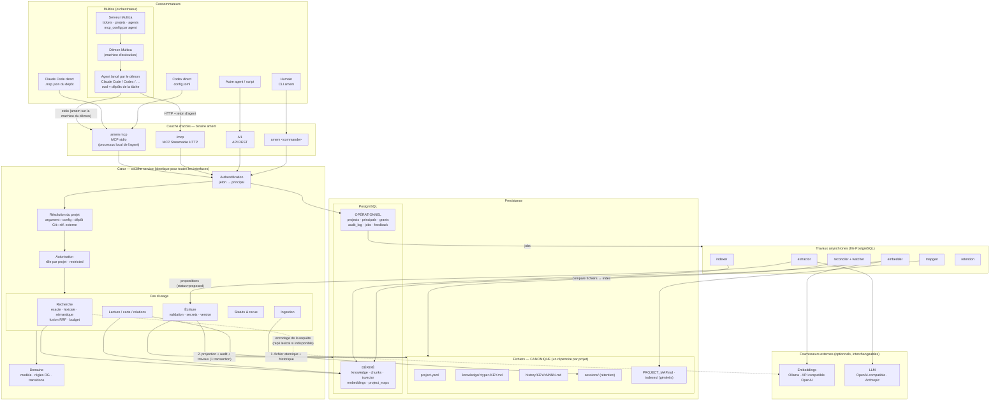
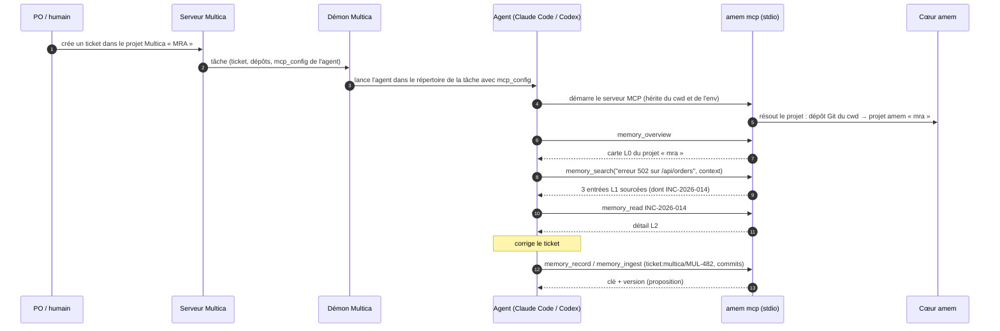

# Spécification générale — Agent Memory Core

**Nom de travail :** Agent Memory Core (`amem`)
**Statut :** Spécification générale — révisée
**Version :** 0.3
**Date :** 20 novembre 2026
**Documents liés :**
- [01 — Spécification fonctionnelle](01-specification-fonctionnelle.md)
- [02 — Spécification technique](02-specification-technique.md)

---

## 0. Journal des modifications

### v0.2 → v0.3

| # | Changement |
|---|---|
| 13 | Ajout de l'architecture globale : schéma abstrait, schéma détaillé et flux principaux (§4.1–4.3) |
| 14 | La mémoire est **par projet** : le « workspace » devient le **projet**, unité de mémoire pouvant regrouper plusieurs dépôts ; ajout de la résolution du projet et de la distinction projet amem / workspace Multica (§4.5) |
| 15 | Intégrations organisées en deux familles (orchestrateurs, agents directs) ; Multica devient le banc d'essai prioritaire, avec Claude Code et Codex lancés directement comme seconde validation (§11, §16, §17-Q7) |
| 16 | Nouvel outil `memory_projects` (projets accessibles et projet résolu) (§10.1) |

### v0.1 → v0.2

| # | Point de la v0.1 | Problème relevé | Décision v0.2 |
|---|---|---|---|
| 1 | « L0 » désigne à la fois la carte du projet et le champ `abstract` d'une connaissance | Ambiguïté de vocabulaire | L0 = carte du projet uniquement. Une connaissance a trois niveaux de lecture : `abstract` (1 phrase), `overview` (L1), contenu (L2). §8 |
| 2 | PostgreSQL stocke « métadonnées, versions » alors que les dérivés doivent être régénérables | Contradiction : si PostgreSQL est perdu, l'historique l'est aussi | Les **fichiers** sont canoniques, historique compris. PostgreSQL ne contient que des données dérivées **ou** opérationnelles (droits, audit, files de travaux), classées explicitement. §4.6 |
| 3 | `status` mélange validité (`confirmed`, `disputed`) et cycle de vie d'incident (`resolved`) | Une connaissance « confirmée » et « résolue » ne peut pas être exprimée | Deux champs : `status` (validité) et `resolution` (incidents uniquement). §6 |
| 4 | `confidence` sans format | Risque de score flottant pris pour une probabilité | Énuméré `low` / `medium` / `high` + justification textuelle. §6 |
| 5 | `memory_write` et `memory_record_knowledge` se recouvrent | Deux façons de créer la même chose | Un seul outil de création structurée (`memory_record`) et un outil d'ingestion brute (`memory_ingest`) qui alimente l'extraction. §10 |
| 6 | MCP arrive en phase 5 | Les agents sont les utilisateurs principaux : sans MCP, rien n'est testable en conditions réelles avant la fin | Serveur MCP minimal et adaptateur Claude Code avancés en phase 2. §16 |
| 7 | Rien sur la promotion d'une connaissance extraite | Risque de transformer une hypothèse en fait | Toute connaissance extraite naît `proposed` ; la promotion `confirmed` exige un curateur ou une preuve vérifiable. §5.2 |
| 8 | Suppression non définie | Conflit avec audit et provenance | Suppression logique (tombstone) par défaut ; purge physique réservée à l'administrateur. §5.5 |
| 9 | Pas de budget de taille pour les réponses | Objectif « limiter le contexte » non mesurable | Budgets de tokens explicites par niveau et par réponse. §8.5 |
| 10 | Questions ouvertes §17 | Bloquent la spécification technique | Tranchées en §17 (avec ce qui reste à valider). |
| 11 | Recherche « sans LLM » alors que la recherche sémantique exige d'encoder la requête | Promesse imprécise | « Sans LLM génératif » ; l'encodage de requête est un appel d'embedding, avec repli lexical si indisponible. §9.2 |
| 12 | Identifiants : `INC-2026-014` en exemple, `id` « stable » sans format | Format non défini | Double identifiant : ULID interne + identifiant lisible préfixé par type, unique par projet. §6 |

---

## 1. Vision

Concevoir un système de mémoire durable, portable et indépendant des plateformes d'agents IA. Il doit pouvoir être utilisé avec Multica, Omnara, Claude Code, Codex ou tout autre agent compatible, sans dépendre de leur infrastructure ni de leur cycle de vie.

La mémoire appartient à un **projet**, généralement associé à un projet logiciel, et non à un agent, une session, un runtime, une VM ou un orchestrateur.

Un agent doit pouvoir retrouver une connaissance utile **en une opération** (recherche renvoyant des résumés sourcés), **deux** au plus s'il a besoin du détail, sans parcourir manuellement le dépôt ou la mémoire.

## 2. Objectifs

1. Persister les connaissances indépendamment des runtimes et des outils d'agents.
2. Partager les connaissances entre agents et sessions, avec contrôle d'accès.
3. Fournir une carte d'entrée compacte (L0) pour comprendre rapidement le projet.
4. Orienter la recherche vers les bons thèmes, composants et documents.
5. Combiner recherche lexicale, recherche sémantique et filtres structurés.
6. Limiter les allers-retours et le volume de contexte injecté.
7. Conserver sources, preuves, dates, versions, statut de validité et niveau de confiance.
8. Permettre une installation locale autonome ou un déploiement serveur partagé.
9. Exposer MCP, une API HTTP et une CLI offrant les mêmes capacités.
10. N'imposer ni orchestrateur, ni modèle, ni fournisseur d'embeddings, ni agent.

## 3. Hors périmètre initial

- Remplacer le système de fichiers ou le gestionnaire de versions du projet.
- Modifier le code source du projet.
- Garantir la véracité d'une connaissance générée par un LLM sans validation.
- Construire un graphe de connaissances complexe (seules des relations typées simples sont prévues).
- Dépendre obligatoirement d'un service cloud ou d'un modèle propriétaire.
- Imposer un format de prompt propre à un produit.
- Synchronisation multi-maître hors ligne (reportée, voir §17-Q6).
- Interface web d'administration (la CLI et l'API suffisent en v1).

## 4. Architecture globale

### 4.1 Schéma global (vue abstraite)

Trois familles de consommateurs accèdent, par trois interfaces équivalentes, à un cœur unique. Ce cœur range la connaissance **par projet**, dans des mémoires isolées les unes des autres.

```text
 ┌──────────────────────────────── CONSOMMATEURS ────────────────────────────────┐
 │                                                                               │
 │  Orchestrateurs                Agents directs                 Humains          │
 │  (Multica, …)                  (Claude Code, Codex, autres)   (dev, curateur)  │
 │  lancent des agents            lancés par un développeur      CLI / scripts    │
 │                                                                               │
 └──────────────┬───────────────────────────┬───────────────────────┬────────────┘
                │                           │                       │
                ▼                           ▼                       ▼
 ┌─────────────────────────────── ACCÈS (équivalents) ───────────────────────────┐
 │            MCP (stdio · HTTP)       API HTTP REST          CLI amem            │
 └───────────────────────────────────────┬───────────────────────────────────────┘
                                         ▼
 ┌────────────────────────────── AGENT MEMORY CORE ──────────────────────────────┐
 │                                                                               │
 │   ① Identifier l'appelant  →  ② Résoudre le PROJET  →  ③ Vérifier les droits  │
 │                                                                               │
 │   ④ Retrouver  (carte L0 · recherche L1 · lecture L2)                          │
 │   ⑤ Écrire     (enregistrer · modifier · changer de statut)                    │
 │   ⑥ Apprendre  (ingérer → extraire → proposer → valider)      [asynchrone]     │
 │   ⑦ Entretenir (indexer · cartographier · réconcilier)        [asynchrone]     │
 │                                                                               │
 └───────────────────────────────────────┬───────────────────────────────────────┘
                                         ▼
 ┌──────────────────────────── MÉMOIRES PAR PROJET ──────────────────────────────┐
 │                                                                               │
 │   Projet « mra »          Projet « shop »          Projet « hospital »   …    │
 │   ├ connaissances         ├ connaissances          ├ connaissances            │
 │   ├ historique            ├ historique             ├ historique               │
 │   └ carte, index          └ carte, index           └ carte, index             │
 │                                                                               │
 │   ═══════ cloisons étanches : aucune lecture ni écriture inter-projets ═══════ │
 └───────────────────────────────────────────────────────────────────────────────┘
```

À retenir :
- l'outil qui appelle (Multica, Claude Code, Codex…) ne change **ni les données, ni les opérations** : seuls la configuration de connexion et le mode de résolution du projet diffèrent (§11) ;
- toute opération commence par la résolution du projet ; sans projet résolu, rien n'est lu ni écrit ;
- les étapes ⑥ et ⑦ ne bloquent jamais un agent.

### 4.2 Schéma détaillé



Lecture du schéma :
- **Couche d'accès** : quatre portes d'entrée, aucune logique métier. `amem mcp` (stdio) est lancé par l'agent lui-même, sur sa machine, et hérite de son répertoire courant — c'est ce qui permet de reconnaître le projet par son dépôt Git.
- **Cœur** : chaque appel suit la même chaîne authentification → résolution du projet → autorisation → cas d'usage → règles du domaine.
- **Persistance** : l'écriture va d'abord dans les fichiers (canoniques), puis dans PostgreSQL en une transaction ; tout ce qui est « dérivé » se reconstruit depuis les fichiers.
- **Travaux** : indexation, embeddings, carte, extraction, réconciliation et rétention passent par une file persistante et ne bloquent jamais l'agent.
- **Fournisseurs** : facultatifs ; sans eux, le système fonctionne en recherche lexicale et sans extraction automatique.

### 4.3 Flux principaux

**Tâche Multica (cas de test prioritaire)**



**Agent direct (Claude Code, Codex, autre)** : identique à partir de l'étape 4 ; c'est le développeur qui lance l'agent dans le dépôt, et la configuration MCP vient du dépôt (`.mcp.json`) ou de l'utilisateur (`~/.codex/config.toml`).

**Écriture** : validation du schéma → détection de secrets → contrôle de version → écriture atomique du fichier et de l'historique → transaction PostgreSQL (projection, audit, travaux) → réponse → indexation et régénération de carte en arrière-plan.

### 4.4 Indépendance

Le cœur est un service autonome ; les intégrations sont des adaptateurs de configuration. Une intégration doit pouvoir être ajoutée sans modifier le modèle de données ni le moteur de recherche. Le cœur reste utilisable sans aucun adaptateur.

### 4.5 La mémoire est par projet

**Le projet est l'unité de mémoire.** Une connaissance appartient à exactement un projet ; elle n'appartient ni à un agent, ni à une session, ni à un outil, ni à un orchestrateur.

Un **projet** représente un produit logiciel dans son ensemble, qui peut s'étendre sur plusieurs dépôts. Exemple : le projet `mra` regroupe le backend, le back-office, le site public et l'application mobile, car un incident ou une décision concerne souvent plusieurs de ces dépôts à la fois.

| Attribut du projet | Description |
|---|---|
| `id` | Slug stable et unique (`mra`, `shop-backend`) ; ne change jamais |
| `name`, `description` | Libellé et finalité ; la description alimente la carte L0 |
| `repositories` | 0..n dépôts : URL distante normalisée, chemin local éventuel, rôle (`backend`, `mobile`…). **Un dépôt appartient à un seul projet** |
| `external_refs` | Correspondances avec des outils tiers, ex. `{system: multica, workspace: …, project: …}` |
| `topics` | Vocabulaire de thèmes du projet et alias |
| `governance`, `privacy`, `retention`, `search` | Règles propres au projet |

Règles de modélisation :
- Toutes les entités (connaissances, clés, versions, relations, carte, index, sessions, droits, audit, feedback) portent le `project_id` ; les clés `INC-2026-014` sont uniques **dans** un projet.
- Une relation (`relates_to`, `supersedes`…) ne relie que deux connaissances du même projet.
- Les droits s'accordent par projet : un agent Multica peut être `contributor` sur `mra` et sans accès à `hospital`.
- Aucune recherche ne traverse plusieurs projets ; une recherche « multi-projets » éventuelle (hors v1) exigera de les nommer explicitement et sera auditée.
- Les connaissances transverses (conventions d'entreprise, par exemple) vivent dans un projet dédié (ex. `org-conventions`) auquel les agents ont un accès en lecture, et qu'ils interrogent explicitement.
- **Projet amem ≠ workspace Multica.** Un workspace Multica contient plusieurs projets Multica ; chaque projet Multica est rattaché à un projet amem par `external_refs` (souvent un pour un).

**Résolution du projet** — chaque appel est rattaché à un projet, dans cet ordre :
1. argument explicite `project` de l'appel ;
2. configuration du processus (`--project`, `AMEM_PROJECT`, en-tête HTTP `X-Amem-Project`) ;
3. dépôt Git du répertoire courant de l'agent, ou de ses sous-répertoires immédiats (cas d'une tâche Multica contenant plusieurs dépôts) : l'URL distante normalisée est cherchée dans `repositories` ;
4. référence externe fournie par le contexte de l'orchestrateur (ex. identifiant de projet Multica) ;
5. si le principal n'a accès qu'à un seul projet : ce projet.

Sinon l'appel échoue avec `project_required` et la liste des projets accessibles. Deux indices contradictoires (ex. argument `shop` mais dépôt de `mra`) ne sont pas une erreur : l'argument explicite l'emporte, et la réponse le signale.

### 4.6 Classification des données

| Classe | Contenu | Localisation | Perte acceptable ? |
|---|---|---|---|
| **Canonique** | Documents de connaissance (Markdown + en-tête YAML), historique des versions, configuration du projet | Répertoire du projet | Non — sauvegarde obligatoire |
| **Dérivée** | Métadonnées indexées, tranches (chunks), index lexical, embeddings, carte L0, index thématiques | PostgreSQL + fichiers générés | Oui — reconstruite par `amem index rebuild` |
| **Opérationnelle** | Principaux, jetons, droits, journal d'audit, file de travaux, retours (feedback), sessions ingérées | PostgreSQL (+ répertoire `sessions/`) | Non pour droits et audit — sauvegarde séparée ; travaux et sessions selon rétention |

Règles :
- Une donnée dérivée n'est jamais l'unique copie d'une connaissance.
- Toute connaissance conserve ses références vers les sources qui la justifient.
- Le répertoire canonique peut être versionné avec Git par l'utilisateur ; le système ne l'exige pas.

### 4.7 Recherche progressive

| Niveau | Objet | Budget cible | Quand |
|---|---|---|---|
| L0 | Carte du projet | ≤ 1 500 tokens (plafond 2 000) | Démarrage de session, injectée par l'adaptateur |
| L1 | Entrées de résultat : `abstract` + `overview` + métadonnées + sources | ≤ 250 tokens par entrée, ≤ 1 500 tokens par réponse par défaut | Réponse de recherche |
| L2 | Document détaillé | Non borné, paginé au-delà de 8 000 tokens | Lecture explicite d'un résultat |

La carte L0 oriente mais n'est pas un passage obligé : la recherche interroge directement les index.

## 5. Sous-systèmes

### 5.1 Storage
Stocke les documents et leur historique, gère les projets, garantit l'écriture atomique et le contrôle de concurrence, fournit export et sauvegarde. Abstrait derrière une interface (système de fichiers local en v1, stockage objet ultérieurement).

### 5.2 Extraction
Transforme des matériaux bruts (transcriptions de session, rapports de tâche, notes) en connaissances proposées : faits, symptômes, causes, solutions, décisions, points non résolus. Produit `abstract` et `overview`, relie chaque affirmation à une source et qualifie sa nature : **observé**, **hypothèse**, **proposition**, **conclusion**.

Règles :
- Asynchrone, ne bloque jamais l'agent.
- Toute connaissance extraite naît `proposed`, jamais `confirmed`.
- Avant création, détection de doublon : un quasi-doublon devient une proposition de mise à jour liée, pas une nouvelle connaissance.
- Les secrets sont détectés et masqués **avant** tout envoi à un LLM.
- Déclencheurs : appel explicite, fin de tâche/session, après incident ou décision, revue humaine.

### 5.3 Indexing
Analyse les documents, découpe en tranches cohérentes (sections Markdown), construit l'index lexical, calcule les embeddings, régénère carte L0 et index thématiques, invalide les dérivés après modification. Entièrement reconstructible depuis les données canoniques.

### 5.4 Retrieval
Interprète la requête (identifiants exacts, signatures d'erreur, noms de symboles), applique filtres et droits, lance recherche lexicale et vectorielle, fusionne, classe, déduplique, et renvoie des entrées L1 sourcées dans un budget de tokens — ou une réponse explicite « aucune connaissance suffisamment pertinente ». Fonctionne sans LLM génératif ; un enrichissement LLM (reformulation, synthèse) est optionnel.

### 5.5 Governance
Droits d'accès par rôle et par projet, classification `internal` / `restricted`, historique des versions, détection de conflits d'écriture, transitions de statut contrôlées, suppression logique, journal d'audit des opérations sensibles, règles d'exclusion (chemins, motifs, secrets).

## 6. Modèle de connaissance

Une connaissance est une unité durable, identifiable et versionnée, stockée dans **un** fichier Markdown à en-tête YAML.

| Champ | Obligatoire | Description |
|---|---|---|
| `id` | oui | ULID interne, immuable |
| `key` | oui | Identifiant lisible unique par projet : `<PRÉFIXE>-<AAAA>-<NNN>` (ex. `INC-2026-014`) |
| `project_id` | oui | Projet propriétaire |
| `type` | oui | `incident` (INC), `decision` (DEC), `architecture` (ARC), `component` (CMP), `convention` (CNV), `lesson` (LSN), `procedure` (PRC), `note` (NOTE). Immuable |
| `title` | oui | ≤ 120 caractères |
| `abstract` | oui | 1 phrase, ≤ 300 caractères |
| `overview` | oui | Résumé L1, ≤ 1 200 caractères |
| corps Markdown | non | Contenu détaillé L2 |
| `topics` | non | Thèmes (vocabulaire du projet, normalisé en minuscules) |
| `components` | non | Composants / modules concernés |
| `technologies` | non | Technologies concernées |
| `keywords` | non | Termes exacts, alias, signatures d'erreur |
| `status` | oui | Validité : `proposed`, `confirmed`, `disputed`, `obsolete`, `superseded`, `rejected` |
| `resolution` | incidents | `open`, `mitigated`, `resolved`, `wont_fix` |
| `severity` | incidents | `low`, `medium`, `high`, `critical` |
| `confidence` | oui | `low`, `medium`, `high` |
| `confidence_note` | non | Justification de la confiance |
| `claims` | non | Affirmations qualifiées : `{text, kind: observed\|hypothesis\|proposal\|conclusion, source_refs}` |
| `source_refs` | oui pour `confirmed` | Références typées : `git:commit/<sha>`, `file:<chemin>#L10-20@<sha>`, `ticket:<système>/<id>`, `session:<id>`, `url:<url>`, `log:<ref>` |
| `relations` | non | `{type, target}` avec type ∈ `relates_to`, `caused_by`, `fixes`, `duplicates`, `contradicts`, `depends_on` |
| `supersedes` | non | Clé de la connaissance remplacée |
| `classification` | oui | `internal` (défaut) ou `restricted` |
| `origin` | oui | `manual`, `agent`, `extracted`, `imported` |
| `created_by` / `updated_by` | oui | Principal (humain ou agent) |
| `created_at` / `updated_at` | oui | Horodatages UTC ISO 8601 |
| `version` | oui | Entier croissant, sert d'ETag |

Statut, confiance et résolution sont indépendants : un incident peut être `confirmed` + `resolved` + `high`, ou `proposed` + `open` + `low`.

## 7. Organisation documentaire

Les répertoires sont une aide à la navigation ; les thèmes sont des **métadonnées**. Un document n'est jamais copié dans plusieurs dossiers : les index thématiques référencent sa clé canonique.

```text
<projet>/
├── project.yaml              # configuration, vocabulaire de thèmes, exclusions
├── PROJECT_MAP.md              # carte L0 (générée)
├── knowledge/
│   ├── incidents/INC-2026-014.md
│   ├── decisions/
│   ├── architecture/
│   ├── components/
│   ├── conventions/
│   ├── lessons/
│   ├── procedures/
│   └── notes/
├── history/INC-2026-014/v0001.md …   # versions antérieures immuables
├── indexes/                    # vues L1 lisibles (générées)
│   ├── topics/
│   ├── components/
│   └── technologies/
└── sessions/                   # matériaux bruts ingérés (soumis à rétention)
```

## 8. Navigation et récupération

- **L0 — Carte du projet** : finalité du projet, architecture et composants majeurs, technologies, conventions critiques, thèmes disponibles (avec effectifs), incidents ouverts critiques, décisions structurantes, pointeurs vers les index, date de génération. Générée de façon déterministe à partir des métadonnées ; la description libre provient de `project.yaml` ou d'une génération LLM optionnelle.
- **L1 — Entrée de résultat / d'index** : clé, titre, abstract, overview, type, statut, résolution, confiance, composants, technologies, date, sources, raison de la correspondance.
- **L2 — Document détaillé** : contexte, observations, preuves, hypothèses, diagnostic, cause, solution, tests, limites, références.

### 8.4 Parcours cible
1. L'agent envoie une requête et son contexte (fichiers ouverts, composant, message d'erreur).
2. Le moteur applique droits et filtres, lance en parallèle recherche exacte, lexicale et sémantique.
3. Il fusionne, classe, déduplique.
4. Il renvoie les meilleures entrées L1 sourcées, dans le budget de tokens.
5. Si nécessaire, l'agent lit le L2 d'un résultat précis.

### 8.5 Budgets
Chaque appel de recherche accepte `max_tokens` (défaut 1 500, plafond 6 000). Le serveur tronque `overview` puis réduit le nombre d'entrées, et signale la troncature.

## 9. Recherche hybride et classement

- **Exacte** : clés (`INC-2026-014`), mots-clés et signatures déclarés, correspondance prioritaire.
- **Lexicale** : PostgreSQL Full Text Search pondéré (titre > mots-clés > résumés > corps) + trigrammes pour identifiants et fautes de frappe.
- **Sémantique** : pgvector (HNSW, cosinus). Embeddings calculés hors chemin critique. L'encodage de la requête est le seul appel modèle sur le chemin de recherche ; s'il échoue, la recherche continue en mode lexical et le signale (`degraded`).
- **Fusion** : Reciprocal Rank Fusion (k = 60) au niveau connaissance, puis ajustements configurables : statut, confiance, correspondance composant/technologie, fraîcheur à décroissance douce. Poids versionnés et évalués sur un jeu de tests.
- **Bruit** : exclusion par défaut de `obsolete`, `superseded`, `rejected` (réintégrables par filtre) ; repli des chaînes de remplacement sur la version courante ; signalement des `disputed` ; regroupement des incidents récurrents ; seuil de pertinence minimal.
- Les scores ne sont jamais présentés comme des probabilités de vérité.

## 10. Interfaces

Les trois interfaces s'appuient sur la même couche de service ; aucune capacité n'est propre à l'une d'elles.

### 10.1 Outils MCP (v1)
| Outil | Rôle |
|---|---|
| `memory_projects` | Projets accessibles et projet résolu pour l'appel courant |
| `memory_overview` | Carte L0 du projet |
| `memory_search` | Recherche hybride → entrées L1 |
| `memory_read` | Document L2 (ou version donnée) |
| `memory_record` | Créer une connaissance structurée |
| `memory_update` | Modifier une connaissance (version attendue obligatoire) |
| `memory_set_status` | Transition de statut (confirmer, contester, rendre obsolète, rejeter) |
| `memory_related` | Connaissances liées |
| `memory_ingest` | Déposer un matériau brut pour extraction asynchrone |
| `memory_feedback` | Signaler un résultat utile, inutile, faux ou périmé |

Transports : stdio (local) et Streamable HTTP (serveur).

### 10.2 API HTTP
REST JSON versionnée (`/v1`), authentification par jeton, pagination par curseur, `ETag`/`If-Match`, erreurs RFC 9457, contrat OpenAPI 3.1.

### 10.3 CLI
`amem init | serve | mcp | overview | search | read | record | update | status | related | ingest | review | index | map | eval | backup | restore | token | doctor`.

## 11. Intégrations

Le cœur ne connaît aucun produit. Une intégration se limite à trois choses : **comment l'outil lance ou joint amem**, **comment le projet est résolu**, **sous quelle identité l'agent agit**. Les outils MCP, leurs paramètres et leurs réponses sont strictement les mêmes pour tous. Une intégration n'altère jamais le stockage interne du produit.

Deux familles doivent fonctionner dès la v1 :

| | Orchestrateur (Multica, et similaires) | Agent direct (Claude Code, Codex, autres) |
|---|---|---|
| Qui lance l'agent | Le démon de l'orchestrateur, pour un ticket | Le développeur, dans son dépôt |
| Où vit la config MCP | Dans l'orchestrateur (`mcp_config` de l'agent, ou serveur MCP du workspace lié à l'agent) | Dans le dépôt (`.mcp.json`) ou la config utilisateur (`~/.codex/config.toml`) |
| Transport | stdio (amem installé sur la machine du démon) **ou** HTTP vers un serveur amem partagé | stdio (local) ou HTTP |
| Résolution du projet | Dépôt(s) Git de la tâche ; ou `project` fixé par agent ; ou référence externe Multica | Dépôt Git courant ; ou `--project` |
| Identité | Un jeton par agent Multica → `agent:multica/<nom>` | `agent:<client>@<hôte>` (local) ou jeton |
| Fin de tâche | Instructions de l'agent : `memory_record` / `memory_ingest` avec `ticket:multica/<id>` | Instructions projet (`CLAUDE.md`, `AGENTS.md`) |

Chaque intégration fournit : la configuration (générée par `amem adapter install <outil>`), un court bloc d'instructions (« consulter `memory_overview` au démarrage, `memory_search` avant de diagnostiquer ou décider, enregistrer ce qui a été appris en fin de tâche »), et une vérification de bout en bout (`amem adapter check <outil>`).

**Banc d'essai prioritaire : Multica**, car il exerce les deux familles à la fois (il lance Claude Code et Codex). La validation exige aussi un test avec Claude Code et Codex lancés directement. Ordre ensuite : Omnara (selon points d'extension vérifiés), puis guide d'intégration générique.

## 12. Concurrence, cohérence, résilience

- Contrôle optimiste par version (ETag) ; tout conflit est renvoyé, jamais écrasé.
- Écriture atomique des fichiers (fichier temporaire + `fsync` + renommage).
- Idempotence des créations via clé d'idempotence fournie par le client.
- File de travaux persistante pour indexation et extraction, reprise après redémarrage, retries avec backoff, lettres mortes.
- Réconciliation au démarrage et périodique : détection des documents dont l'index est périmé ou divergent.
- Sauvegarde et restauration documentées et testées.
- Un seul nœud écrivain par projet en v1 (verrou), les autres instances servent la lecture.

## 13. Sécurité et confidentialité

- Isolation stricte entre projets, vérifiée par tests automatisés.
- Authentification de chaque principal (humain ou agent) ; rôles `reader`, `contributor`, `curator`, `admin` par projet.
- Classification `restricted` lisible seulement par `curator`+ ou par octroi explicite.
- Détection de secrets à l'écriture et à l'ingestion : rejet (écriture structurée) ou masquage (ingestion).
- Chemins et motifs interdits configurables.
- Audit des écritures, changements de statut, lectures `restricted`, administration.
- TLS en transit ; chiffrement au repos délégué au support (disque, base) en v1.
- **Injection d'instructions** : le contenu restitué est une donnée ; il est encapsulé dans des champs structurés, marqué non fiable, et les motifs d'instruction suspects sont signalés.
- Provenance toujours visible.

## 14. Observabilité et mesures

Techniques : latence p50/p95 par canal, temps d'indexation, taille des index, échecs et reprises de travaux, conflits d'écriture, coût et latence des appels modèles.

Qualité : Recall@k, Precision@k, MRR, nDCG@10, taux de réponses sourcées, taux de résultats obsolètes, taux de seconde lecture, tokens injectés, taux de résolution avec vs sans mémoire.

Objectifs initiaux (à valider) sur un projet de référence de 10 000 connaissances / 100 000 tranches :
- recherche p95 < 500 ms (encodage de requête inclus, embeddings locaux) ;
- résultat attendu dans le top 3 pour ≥ 90 % du jeu d'évaluation ;
- zéro fuite inter-projet ; zéro écrasement silencieux.

## 15. Choix technologiques

Go (service, workers, CLI, un seul binaire) ; PostgreSQL ≥ 16 + pgvector + pg_trgm ; Markdown + YAML ; MCP ; HTTP/JSON ; système de fichiers local avec abstraction. Embeddings et LLM via fournisseurs interchangeables (API compatible OpenAI, Ollama). Go est un choix d'implémentation, pas une contrainte du protocole.

## 16. Phases

| Phase | Contenu | Résultat vérifiable |
|---|---|---|
| 1 — Noyau | Modèle, stockage fichiers, PostgreSQL et migrations, CRUD API/CLI, versions et concurrence, file de travaux, audit | Créer, lire, modifier avec conflit détecté ; reconstruire l'index depuis les fichiers |
| 2 — Recherche lexicale, MCP et Multica | Carte L0, index L1, recherche exacte + lexicale + filtres, résolution du projet, serveur MCP (stdio + HTTP), intégrations Multica, Claude Code et Codex | Un agent lancé par Multica **et** un Claude Code / Codex lancé directement retrouvent un incident du même projet par message d'erreur en un appel |
| 3 — Sémantique et évaluation | Pipeline d'embeddings, pgvector, RRF, jeu d'évaluation, `amem eval` | Mesures Recall@3 publiées, mode dégradé testé |
| 4 — Extraction | Ingestion, extraction LLM, déduplication, revue humaine, transitions de statut | Une session ingérée produit des propositions revues via `amem review` |
| 5 — Intégrations | Omnara, autres orchestrateurs, guide d'intégration générique, résolution par référence externe Multica | Chaque adaptateur testé de bout en bout |
| 6 — Production | Droits fins, `restricted`, sauvegarde/restauration, tests de charge, concurrence, sécurité ; mode local embarqué (SQLite) | Campagne de tests de charge et d'isolation passée |

## 17. Décisions sur les questions ouvertes

| # | Question | Décision v0.2 | Reste à valider |
|---|---|---|---|
| Q1 | Stockage canonique documentaire ou aussi structuré ? | Documentaire uniquement ; la structure est portée par l'en-tête YAML validé par schéma | — |
| Q2 | Mode local sans PostgreSQL ? | Oui, en phase 6, via un backend d'index SQLite (FTS5 + sqlite-vec) derrière la même interface. D'ici là, mode local = binaire + PostgreSQL en conteneur | Performance de sqlite-vec à 100 k tranches |
| Q3 | Modèles d'embeddings | Interface fournisseur ; v1 : API compatible OpenAI (couvre OpenAI, vLLM, LM Studio) et Ollama. Défaut local proposé : un modèle multilingue ~1024 dimensions | Choix du modèle par défaut via le jeu d'évaluation (FR + EN + code) |
| Q4 | Valider sans transformer une hypothèse en fait | Extraction → `proposed` toujours ; `confirmed` exige un curateur, ou une règle de preuve configurée (ex. commit référencé présent sur la branche principale + affirmation de type `observed`) ; les `claims` gardent leur nature | Règles de preuve automatiques à affiner après usage |
| Q5 | Rétention des sessions | Matériaux bruts conservés 30 jours (configurable), puis purgés ; les connaissances qui les citent conservent la référence avec mention « source expirée » | Besoin légal éventuel |
| Q6 | Synchronisation multi-nœuds hors ligne | Hors v1. Modèle v1 : un serveur faisant autorité ; les clients locaux sont sans état. Piste future : répertoire canonique sous Git avec fusion par document et fichiers de conflit | Étude dédiée |
| Q7 | Adaptateurs prioritaires | Multica en premier banc d'essai (via `mcp_config` d'agent, runtimes Claude Code et Codex), validé aussi avec Claude Code et Codex lancés directement ; Omnara ensuite | Versions minimales exactes |

## 18. Critère directeur

Le système est réussi si un agent qui reprend un projet inconnu peut, avec une carte d'entrée courte et une recherche ciblée, retrouver les décisions, incidents et contraintes qui changent réellement la manière de travailler — sans dépendre de l'agent précédent, de son runtime ou de l'orchestrateur utilisé.
